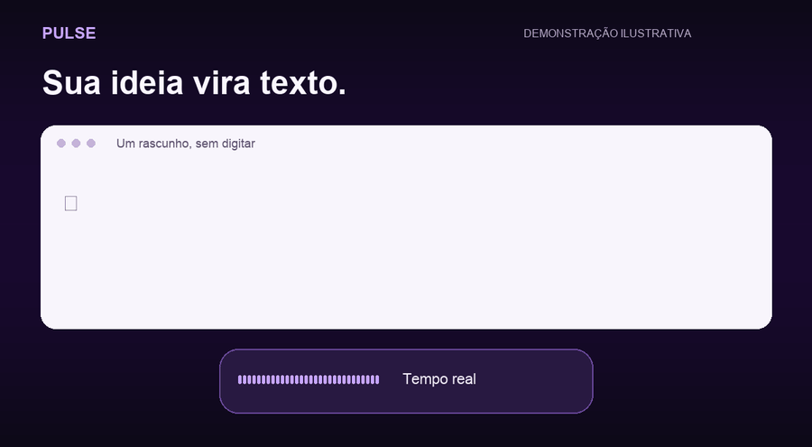

# Sua voz, por escrito.

**Pulse transforma sua fala em texto no Mac.** Para escrever mensagens, organizar ideias e responder e-mails sem digitar cada palavra. Em português do Brasil, com o reconhecimento de voz da Apple no próprio aparelho.

### [↓ Baixar Pulse para Mac](https://github.com/marcoantoniofassa/pulse-community/releases/latest/download/Pulse-1.6.2.dmg)

**macOS 26 ou mais recente · Apple Silicon (M1 ou posterior) · Gratuito · MIT**

[Guia de instalação](docs/instalar.md) · [Como contribuir](CONTRIBUTING.md) · [Privacidade](docs/privacidade.md)

> Esta distribuição não é notarizada pela Apple. Leia o guia para a abertura inicial pelo fluxo normal do macOS. Não há versão para Intel, Windows ou Linux.

*Demonstração ilustrativa, com texto sintético; não é uma medição de velocidade. [Imagem estática](docs/assets/demo.png).*

## Quero usar

1. Baixe o DMG, abra e arraste **Pulse** para **Aplicativos**.
2. Abra o Pulse e conceda as permissões explicadas no [guia](docs/instalar.md).
3. Abra um campo de texto, toque **Option duas vezes**, fale e repita o atalho para colar.

O primeiro uso pode precisar de internet para o macOS baixar o modelo de português. Depois, a transcrição usa o motor local. Você não precisa de conta GitHub, chave de API, terminal ou assistente de IA.

| Quero… | Atalho |
|---|---|
| Gravar e colar ao terminar | Option duas vezes; repita para parar |
| Usar uma alternativa ao duplo toque | Option + S |
| Ver o texto enquanto falo | Option + Espaço; repita para parar |
| Cancelar | Esc |

No tempo real, mantenha o cursor no mesmo campo. O Pulse envia teclas e correções ao campo em foco; Esc interrompe, mas não apaga texto já digitado. Revise antes de enviar mensagens.

## Seu texto fica no seu Mac

Sem conta, assinatura, telemetria ou serviço de transcrição do Pulse. O histórico local guarda texto, duração e aplicativo por até 72 horas, com limpeza ao abrir/salvar. O texto final também passa pela área de transferência. [Veja os dados armazenados e como apagá-los](docs/privacidade.md).

## Quero contribuir

O aplicativo é Swift nativo, com frameworks da Apple e sem dependências externas de runtime. [CONTRIBUTING](CONTRIBUTING.md) explica como gerar um build sem sobrescrever sua instalação.

[Relatar problema](https://github.com/marcoantoniofassa/pulse-community/issues/new/choose) · [Reportar vulnerabilidade em privado](https://github.com/marcoantoniofassa/pulse-community/security/advisories/new)

## De onde veio

Edição comunitária baseada no Pulse 1.6.1, commit `4d4b5d9be6b47ca2360fbda0864725f4e05e4a31`. A 1.6.2 remove conteúdo de ditado dos diagnósticos, usa sons próprios e oferece empacotamento sem instalação automática. O histórico anterior permanece privado; esta edição começa com uma árvore revisada. [Origem e créditos](CREDITS.md) · [Mudanças](CHANGELOG.md).
